<p align="center">
  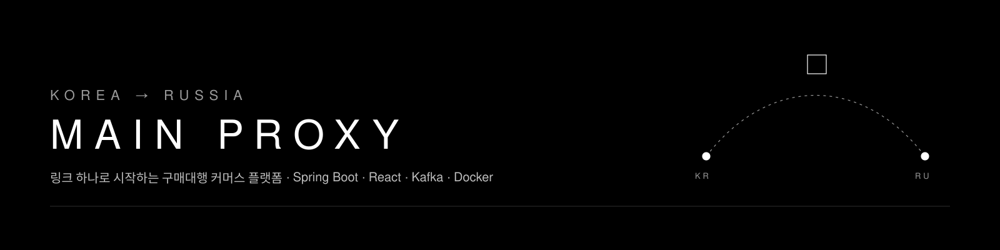
</p>

<h1 align="center">Main Proxy</h1>

<p align="center">
  한국 쇼핑몰 상품을 <b>링크 하나로</b> 요청하면, 대신 구매하고 검수해서 러시아까지 배송하는<br>
  <b>구매대행 커머스 플랫폼</b> — 스토어 · 지갑 · 환율 · 실시간 상담 · 관리자 콘솔 · 푸시 알림 · 3개 언어
</p>

<p align="center">
  
  
  
  
  
  
  
  
  
  
  <a href="LICENSE"></a>
</p>

<p align="center">
  <a href="#-빠른-시작">빠른 시작</a> ·
  <a href="#-기능">기능</a> ·
  <a href="#%EF%B8%8F-화면">화면</a> ·
  <a href="#-관리자-콘솔">관리자 콘솔</a> ·
  <a href="#%EF%B8%8F-설정">설정</a> ·
  <a href="#%EF%B8%8F-아키텍처">아키텍처</a> ·
  <a href="#-커스터마이징">커스터마이징</a> ·
  <a href="#-배포">배포</a> ·
  <a href="docs/ENGINEERING.md">엔지니어링 노트</a> ·
  <a href="https://main-proxy.com">운영 사이트</a>
</p>

<p align="center">
  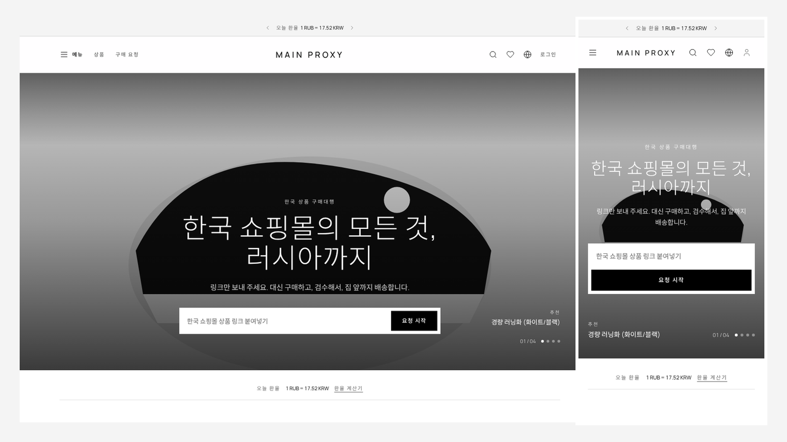
</p>

<details>
<summary><b>English summary</b></summary>
<br>

**Main Proxy** is a purchasing-agent commerce platform for buying from Korean online shops and shipping to Russia. Visitors browse an admin-curated catalogue, paste a shop link to start a request, save products to a wishlist and turn several of them into one request; members pay from a KRW wallet funded by bank transfer, follow each status change with push notifications and talk to staff in a real-time chat. Staff run everything from an operations-desk console that opens with what needs a hand today, groups its pages by the work (operations, commerce, customers, content) and jumps anywhere with ⌘K: products, exchange rates (CBR feed or manual), deposits, wallets, requests, inquiries, notices and chat, on a phone too. Spring Boot 3 + React 18 + Kafka push service + Android WebView app, in Korean, Russian and English. One `docker compose up` brings up the whole stack; `./script/e2e-smoke.sh` runs 38 browser-driven checks against a real backend.

</details>

---

## ✨ 왜 Main Proxy인가

- **구매대행에 맞춘 흐름** — 장바구니·결제 대신 *링크 → 요청 → 지갑 차감 → 구매·검수 → 배송*. 상품 페이지와 찜 목록에서 구매 요청 폼이 자동으로 채워집니다.
- **스토어가 곧 영업 채널** — 관리자가 사진과 함께 상품을 등록하면 즉시 카테고리 패널·추천 레일·카탈로그에 노출됩니다. 메인 히어로는 서비스를 소개하는 자체 아트워크(서울 → 모스크바 경로 애니메이션)가 기본이고, 관리자 콘솔에서 브랜드 이미지로 바꿀 수 있습니다. 셀렉트숍 수준의 흑백 에디토리얼 디자인이 기본값입니다.
- **운영에 필요한 것이 다 들어 있음** — 환율(중앙은행 자동 수집 또는 수동), 입금 확인과 불변 원장 기반 지갑, STOMP 실시간 상담, 역할 기반 관리자 콘솔, FCM 푸시, 한·러·영 3개 언어.
- **운영 데스크처럼 쓰는 콘솔** — 대시보드는 "오늘 처리할 일이 9건 있습니다"라는 한 문장으로 열리고, 메뉴는 운영·상거래·고객·콘텐츠로 묶인 잉크 레일에, 어디든 ⌘K 한 번으로 갑니다. 폰에서도 같은 콘솔이 그대로 열립니다.
- **하루 안에 띄우는 배포** — Docker Compose 한 번으로 6개 컨테이너가 올라오고, 스키마와 첫 관리자 계정은 스크립트 한 줄로 만듭니다. AWS(EC2 · RDS · S3 · ALB) 참고 구성과 프로비저닝 스크립트도 포함돼 있습니다.

---

## 🚀 빠른 시작

### Docker로 5분 안에 (권장)

```bash
git clone https://github.com/ruxpress0228/ruxpress.git && cd ruxpress
cp back/.env.example back/.env     # 기본값은 동봉된 MariaDB 기준. JWT_SECRET 만 바꿔도 됩니다
docker compose up -d --build       # mariadb · kafka · backend · frontend(nginx) · push 서비스
./script/init-db.sh                # 최초 1회: 스키마 생성 + 첫 관리자 계정
```

| 주소 | 설명 |
|------|------|
| http://localhost | 스토어 (비회원 랜딩 → 회원가입 → 구매 요청) |
| http://localhost/admin | 관리자 콘솔 — `admin@example.com` / `admin1234` (로그인 후 바로 변경) |
| http://localhost:8080/api/health | 백엔드 헬스체크 |

> 푸시 알림까지 쓰려면 Firebase 서비스 계정 파일을 `secrets/firebase-admin.json`에 두세요. 없어도 나머지 서비스는 정상 동작합니다.
> 회원가입 이메일 인증을 쓰려면 `back/.env`의 `MAIL_*`을 채우세요.

### 소스에서 실행 (개발)

```bash
cd back  && mvn spring-boot:run -Dspring-boot.run.profiles=h2   # :8080, H2 메모리 DB + 시드 계정, Kafka 불필요
cd front && npm install && npm run dev                           # :3000, /api·/ws 는 :8080 으로 프록시
```

`h2` 프로필은 관리자 `admin@ruxpress.com` / `admin1234`, 회원 `test1@test.com` / `test1`을 자동으로 만듭니다. 실제 MariaDB로 개발하려면 기본 `local` 프로필에 `DB_*` 환경변수를 주세요.

### 한 줄로 전체 시나리오 검증

```bash
./script/e2e-smoke.sh   # 백엔드(H2) + Vite + Chromium: 상품 등록부터 구매 요청 제출까지 38개 검사
```

---

## 🧭 기능

<table>
<tr>
<td width="33%" valign="top">

**🛍️ 스토어 (비회원도 이용)**

- 서비스를 소개하는 전면 히어로 랜딩 — 기본 아트워크(서울 → 모스크바 경로 애니메이션) 또는 관리자가 올린 브랜드 이미지
- 링크 붙여넣기 → 요청 시작 입력창
- 카테고리 패널 · 추천 상품 · 지금 많이 보는 상품
- 카탈로그: 카테고리 · 검색 · 정렬(추천/최신/인기/가격) · NEW 표시
- 상품 상세: 공유 · 확대 · 가격 기준일 · 관련 상품 · 최근 본 상품
- 상단 공지 줄에 오늘 환율, 헤더 검색 시트
- 이용 안내(수수료는 서버 설정값), 공지사항

</td>
<td width="33%" valign="top">

**👤 회원**

- 찜(하트) → 찜 목록에서 여러 상품을 **하나의 구매 요청으로**
- 구매 요청: 항목별 링크·단가·수량·옵션, 배송지 스냅샷, 상태 추적
- 지갑: 계좌이체 입금 신고 → 확인 후 잔액 반영, 원장 내역
- 실시간 1:1 채팅(파일 첨부) · 문의 게시판
- 이메일 가입·인증, 자동 로그인, 비밀번호 재설정
- 필요할 때만 뜨는 로그인 시트, 로그인 후 원래 위치로 복귀
- 한국어 · 러시아어 · 영어

</td>
<td width="33%" valign="top">

**🛠️ 관리자 콘솔**

- 운영 데스크 대시보드: 오늘 처리할 일(답변 대기 · 신규 요청 · 입금 확인)을 한 문장과 큐로, 최근 문의·요청, 오늘의 환율
- 잉크 레일 내비게이션(운영 · 상거래 · 고객 · 콘텐츠), 접히는 아이콘 레일, ⌘K 이동 팔레트
- 상품 등록·수정·숨김, 이미지 업로드, 추천·정렬, 조회수, 메인 히어로 이미지
- 환율: 러시아 중앙은행 자동 수집 또는 수동 설정, 다중 통화
- 입금 확인 · 정산 계좌 · 지갑 수동 조정(원장 기록)
- 구매 요청 상태 전이(접수 → 구매 → 배송 → 완료)
- 상담 채팅 콘솔, 보존 기간 설정
- 공지 · 문의 · 알림 · 수수료율 · 관리자 계정(SUPER_ADMIN / COUNSELOR)
- 회원 상태 관리, 대시보드 통계

</td>
</tr>
</table>

---

## 🖼️ 화면

> 목 데이터로 찍은 화면입니다. 상품 사진 자리의 그림은 README용 샘플 일러스트이며, 실제로는 관리자가 올린 사진이 들어갑니다. 메인 히어로는 기본 아트워크 상태입니다.

| 랜딩 (비회원) | 상품 카탈로그 |
|:--:|:--:|
| 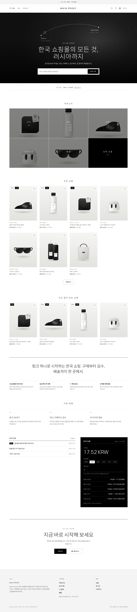 | 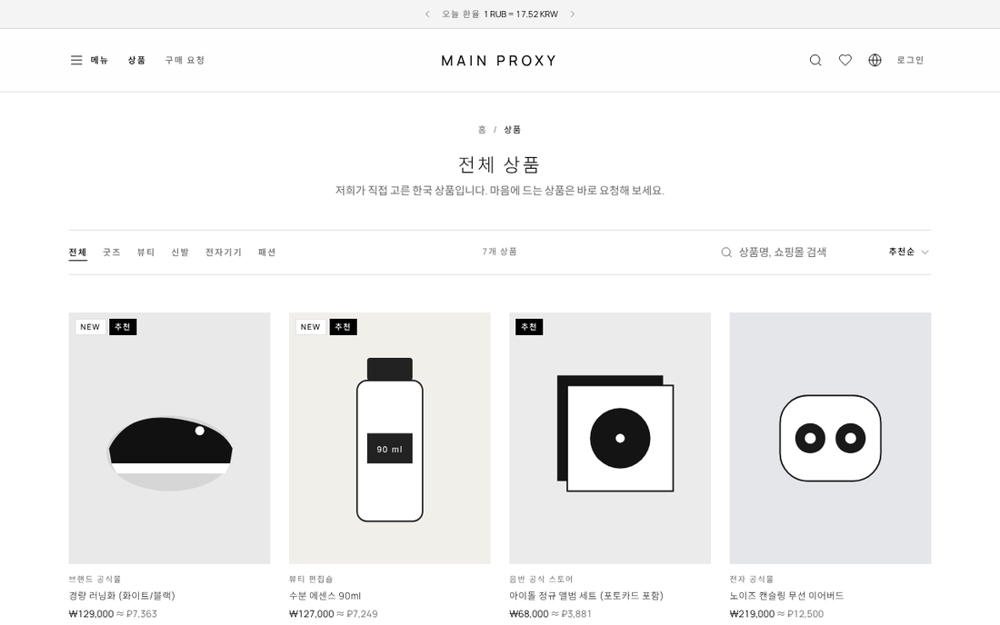 |

| 상품 상세 | 찜 목록 → 구매 요청 |
|:--:|:--:|
| 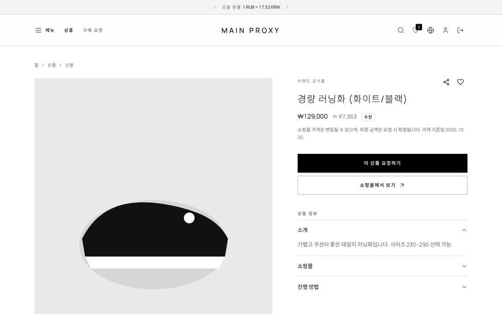 | 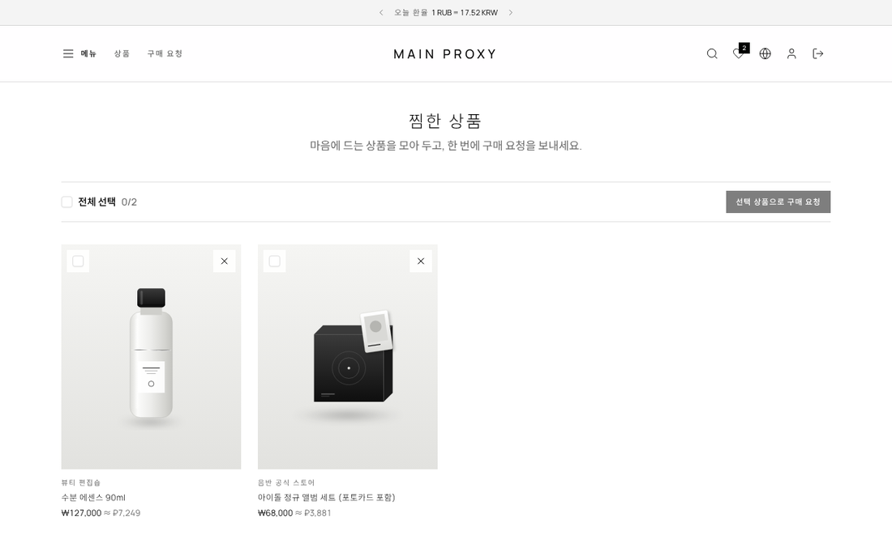 |

| 회원 홈 | 모바일 — 랜딩 · 메뉴 · 상품 상세 |
|:--:|:--:|
| 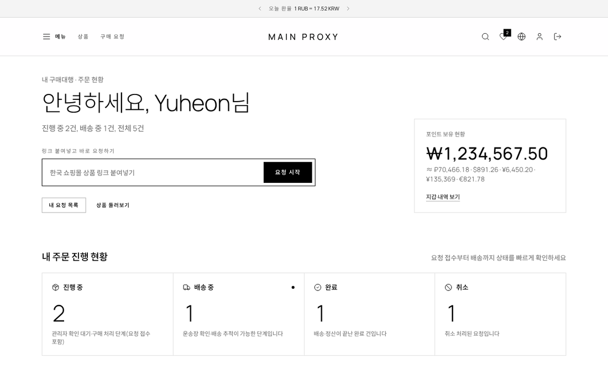 | 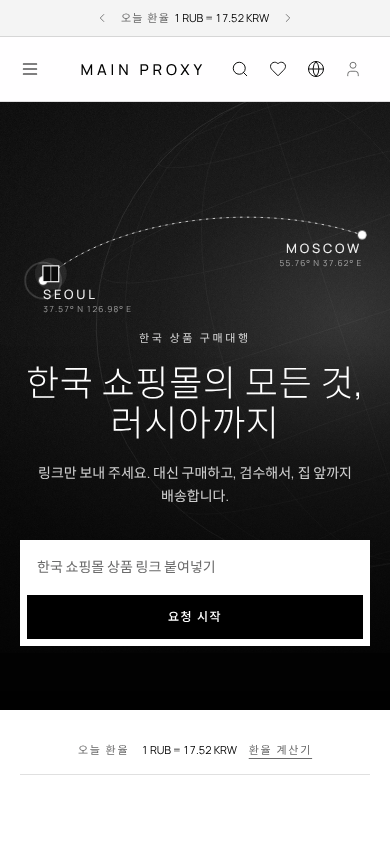 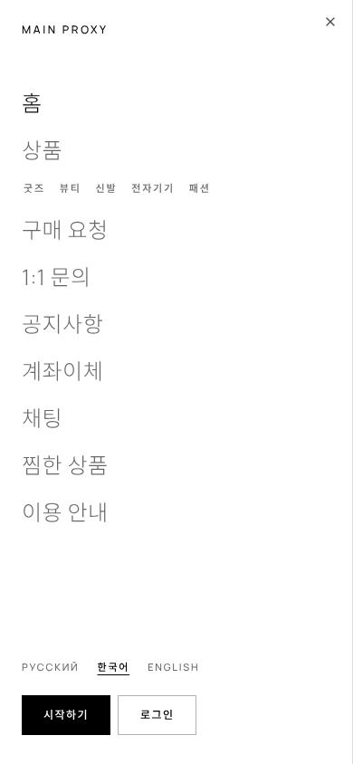 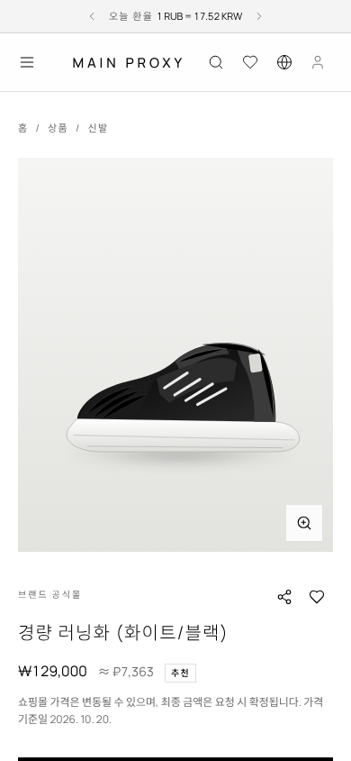 |

---

## 🧭 관리자 콘솔

<p align="center">
  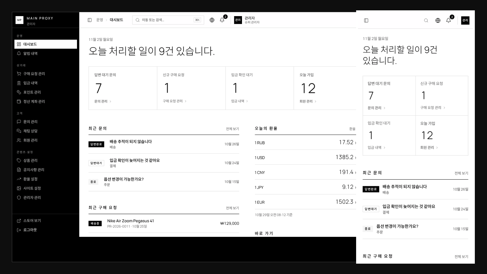
</p>

운영자가 하루를 시작하는 화면을 **운영 데스크**로 설계했습니다. 제목 대신 문장으로 열리고, 숫자는 바로 그 일로 이어집니다.

- **한 문장 대시보드** — "오늘 처리할 일이 9건 있습니다." 아래에 답변 대기 문의 · 신규 구매 요청 · 입금 확인 대기 · 오늘 가입이 큐로 놓이고, 각 칸이 해당 화면으로 갑니다. 최근 문의·요청, 오늘의 환율, 바로 가기가 이어집니다.
- **잉크 레일** — 검은 바탕의 메뉴가 운영 · 상거래 · 고객 · 콘텐츠·설정 네 묶음으로 정리되고, 현재 페이지는 흰 도장처럼 찍힙니다. 버튼 하나로 아이콘 레일로 접힙니다.
- **⌘K 팔레트** — 페이지 이름 몇 글자로 이동, 스토어 열기, 언어 전환, 로그아웃. 상단 바에는 위치(상거래 › 구매 요청 관리)와 알림, 관리자 칩만 남깁니다.
- **폰에서도 그대로** — 레일은 시트로, 넓은 표는 옆으로 스크롤되며 더 있는 쪽에 페이드가 생깁니다. 채팅 상담은 목록과 대화가 한 화면씩 번갈아 열립니다.
- **권한에 맞게** — 상담사(COUNSELOR)로 들어오면 볼 수 없는 메뉴와 숫자는 조용히 빠집니다.

| 상품 관리 | 로그인 |
|:--:|:--:|
| 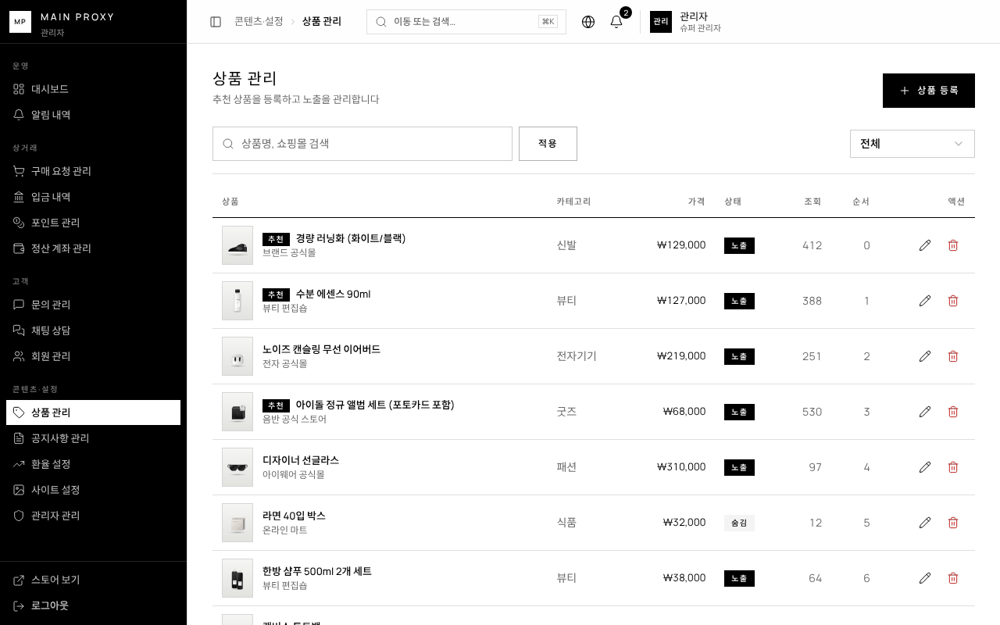 | 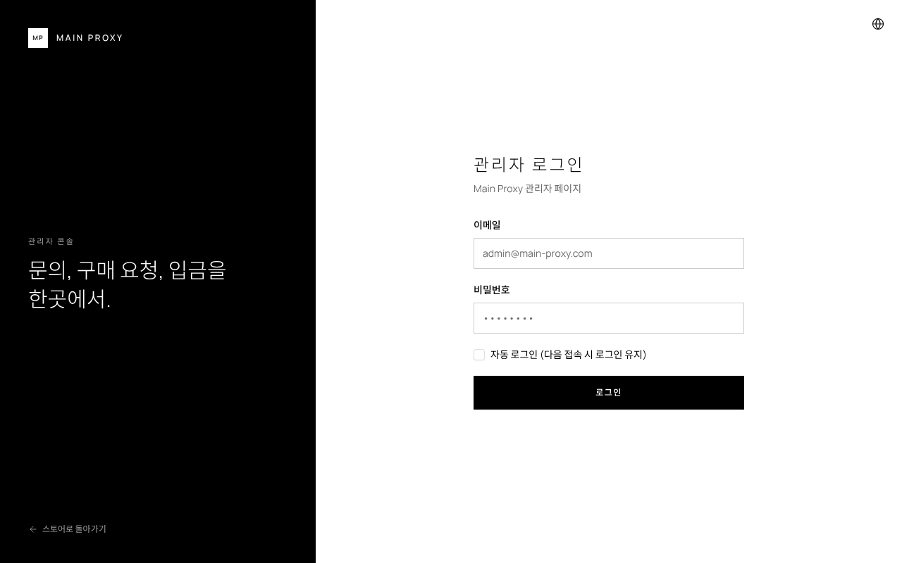 |

<p align="center">
  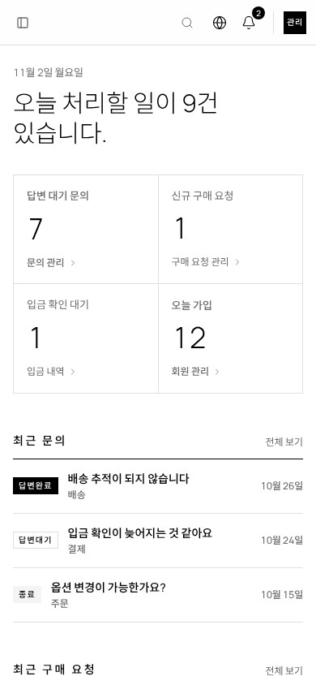
  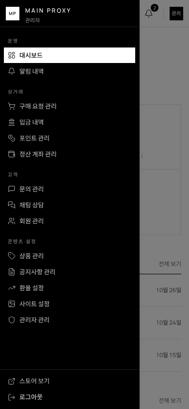
  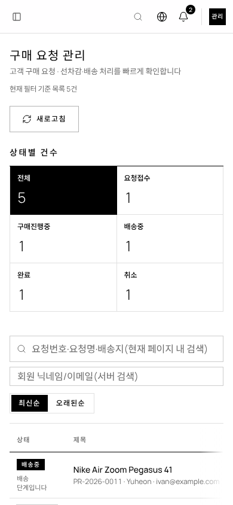
  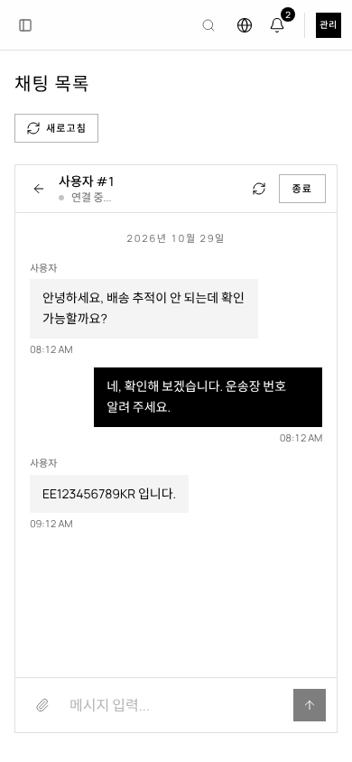
</p>

---

## ⚙️ 설정

백엔드는 `back/.env`(또는 환경변수)로 설정합니다. 전체 목록과 설명은 [`back/.env.example`](back/.env.example)에 있습니다.

| 변수 | 기본값 | 설명 |
|------|--------|------|
| `DB_HOST` `DB_PORT` `DB_NAME` `DB_USERNAME` `DB_PASSWORD` | 동봉 MariaDB | 외부 DB(RDS 등)를 쓰면 여기만 바꿉니다 |
| `JWT_SECRET` `JWT_EXPIRATION` | — / 7일 | **운영에서는 반드시 교체** (32자 이상) |
| `STORAGE_TYPE` | `local` | `local`(컨테이너 디스크) 또는 `s3` + `S3_BUCKET` `S3_REGION` `S3_ACCESS_KEY` `S3_SECRET_KEY` |
| `MAIL_HOST` `MAIL_PORT` `MAIL_USERNAME` `MAIL_PASSWORD` `MAIL_FROM` | — | 가입 인증·비밀번호 재설정 메일 |
| `FRONTEND_BASE_URL` `CORS_ALLOWED_ORIGINS` | `http://localhost` | 운영 도메인으로 교체 |
| `RUXPRESS_KAFKA_PUBLISH` `RUXPRESS_KAFKA_CONSUME_RESULTS` | `true` (compose) | 푸시 이벤트 발행·결과 수신. 푸시를 안 쓰면 `false` |

프런트엔드는 빌드 시 설정이 필요 없습니다. 개발 서버의 API 프록시 대상만 `VITE_API_TARGET`(기본 `http://localhost:8080`)으로 바꿀 수 있습니다.

**데이터베이스 스키마**

| 상황 | 할 일 |
|------|------|
| 신규 설치 | `./script/init-db.sh` (compose) 또는 `mysql … < sql/DDL.sql` (외부 DB) |
| 기존 설치에 상품·찜 추가 | `sql/migration_products.sql` → `sql/migration_wishlist.sql` |
| 그 외 변경 이력 | `sql/migration_*.sql` 을 순서대로 적용 |

---

## 🏗️ 아키텍처

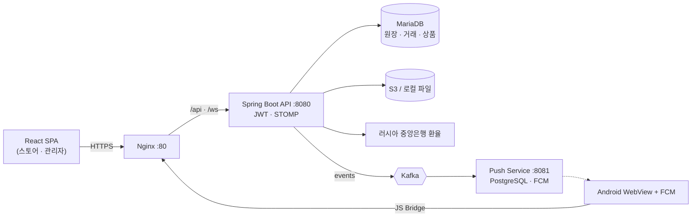

| 구성 | 기술 | 역할 |
|------|------|------|
| `back/` | Java 21 · Spring Boot 3.2 (Web, Data JPA, Security, WebSocket, Kafka, Mail) | 15개 도메인 모놀리식 API, 불변 원장, 포트·어댑터(입금 검증·파일 저장) |
| `front/` | React 18 · TypeScript 5.6 · Vite 6 · Tailwind 4 · Radix · React Router 7 | 스토어 + 관리자 SPA, 코드로 정의한 디자인 토큰과 페이지 키트, 3개 언어 |
| `mobilePush/` | Spring Boot · Kafka · PostgreSQL(Flyway) · Firebase Admin | 푸시 발송을 핵심 거래와 분리한 마이크로서비스 |
| `app/android/` | Kotlin · WebView · FCM | 웹을 감싼 하이브리드 앱, 토큰·푸시 컨텍스트 동기화 |
| `docker-compose.yml` | MariaDB 11 · Kafka 3.7(KRaft) · PostgreSQL 16 · Nginx | 6개 컨테이너 풀스택 |

설계 결정(불변 원장, 헥사고날 포트, Kafka 장애 격리, STOMP 인증, 디자인 시스템, 로그인 게이트, 장바구니 없는 커머스)과 도메인·인프라 상세는 [엔지니어링 노트](docs/ENGINEERING.md)에 있습니다.

---

## 🎨 커스터마이징

| 바꾸고 싶은 것 | 위치 |
|----------------|------|
| 브랜드 이름·워드마크 | `front/src/components/brand/BrandMark.tsx` (텍스트 워드마크 — 로고 이미지가 있으면 여기서 교체) |
| 색·모서리·서체·타이포 스케일 | `front/src/styles/theme.css` — 토큰 몇 줄로 사용자·관리자 37개 화면이 함께 바뀝니다 |
| 문구와 언어 | `front/src/i18n/{ko,ru,en}.json` (1,265개 키, 세 언어 동일). 언어를 추가하려면 JSON 하나와 `LOCALES` 한 줄 |
| 상품 카테고리 | 관리자 등록 화면에서 자유 입력 — 카탈로그 칩·메뉴·패널에 자동 반영 |
| 수수료율 · 환율 | 관리자 콘솔 → 환율 설정 (`system_settings.fee_rate`, 이용 안내 페이지에도 표시) |
| 메인 히어로 이미지 | 관리자 콘솔 → 사이트 설정 (`/admin/site`) — 업로드·교체·기본 아트워크로 되돌리기. 아트워크 자체는 `front/src/components/landing/HeroArtwork.tsx` |
| 랜딩 문구·섹션 | `front/src/pages/user/Landing.tsx` + `landing.*` 번역 키 |
| 입금 검증 방식 | `BankDepositVerificationPort` 구현체 교체 (현재 수동 확인 어댑터) |
| 파일 저장소 | `STORAGE_TYPE=local` 또는 `s3` — 코드 변경 없음 |

---

## 🔐 보안·운영 메모

- 역할 기반 접근: `SUPER_ADMIN` · `COUNSELOR` · `USER`. 상품·회원·지갑·설정 변경은 SUPER_ADMIN만, 상담은 COUNSELOR도 가능.
- 비회원에게 열린 것: 랜딩, 상품 조회, 공지, 이용 안내, 환율. 찜·요청·채팅·지갑은 회원 JWT 필수.
- 업로드 제한: 파일 10MB / 요청 60MB(Nginx·Spring 동일), 상품 이미지와 메인 히어로 이미지는 JPG·PNG·WebP 5MB. 상품 사진과 히어로 이미지는 관리자가 권리를 가진 파일만 올리도록 화면에서 안내하며, 외부 쇼핑몰 이미지를 자동 수집하지 않습니다. 기본 히어로 아트워크는 이 저장소에서 직접 그린 SVG입니다.
- 로그인 복귀 경로(`?next=`)는 내부 경로만 허용해 오픈 리다이렉트를 막습니다.
- 지갑·입금은 덮어쓰기 없는 원장 엔트리로 기록되어 모든 자금 이동에 감사 추적이 남습니다.

---

## 🧪 테스트

| 종류 | 범위 | 실행 |
|------|------|------|
| 백엔드 단위 | 상품·찜·정렬·JSON 계약, 환율 계산, 푸시 페이로드 등 | `cd back && mvn test` |
| 프런트 단위 | 포맷·i18n 키 정합성·링크 변환·최근 본 상품 저장소 (32개) | `cd front && npm test` |
| 타입·빌드 | `tsc` + Vite 빌드 | `cd front && npm run build` |
| E2E 스모크 | 실제 백엔드(H2) + 브라우저: 관리자 상품 등록(이미지 업로드) → 히어로 이미지 설정 → 비회원 탐색·검색·정렬 → 로그인 게이트 → 찜 → 구매 요청 제출(지갑 차감) → 공지 → 상품 숨김 → 로그아웃 (38개 검사) | `./script/e2e-smoke.sh` |

---

## 📦 배포

**어떤 VM이든 Docker Compose로.** 서버에 clone → `back/.env` 작성 → `docker compose up -d --build` → `./script/init-db.sh`. 재배포는 `./script/rebuild.sh`(이미지 재빌드 후 재시작), 운영은 `./script/manage.sh start|stop|restart`.

**GitHub Actions 자동 배포.** `master` 푸시 → `deploy-prod.yml`이 SSH로 서버에 접속해 `git pull` + `rebuild.sh`. 저장소 Settings → Secrets에 아래를 등록하면 동작합니다.

| 시크릿 | 값 |
|--------|----|
| `SSH_HOST_PROD` / `SSH_USER_PROD` | 서버 주소 / 접속 계정 |
| `SSH_PRIVATE_KEY_PROD` | OpenSSH 형식 개인키 (PuTTY `.ppk`는 PuTTYgen → Conversions → Export OpenSSH key) |
| `GH_TOKEN` | 서버에서 `git pull`에 쓸 토큰 (비공개 저장소) |

**AWS 참고 구성.** 운영 사이트는 Route 53 + ALB(HTTPS) + EC2(Compose) + RDS + S3로 돌아갑니다. `script/aws/`에 S3·IAM·RDS 프로비저닝 스크립트(sh/ps1)가 있고, 세부는 [엔지니어링 노트 §6](docs/ENGINEERING.md#6-aws-클라우드-인프라)에 있습니다.

---

## 🗺️ 로드맵

- [x] 스토어형 UI와 디자인 시스템, 비회원 랜딩과 로그인 시트
- [x] 상품 카탈로그 · 찜 → 구매 요청 · 검색 · 정렬 · 조회수
- [x] 실제 백엔드 E2E 스모크 테스트
- [x] 서비스 소개 히어로 아트워크 + 관리자 히어로 이미지 설정
- [ ] 상품 사진 여러 장(갤러리)
- [ ] 상품 후기(관리자 승인제)
- [ ] 신상품·재입고 알림(이메일/푸시)
- [ ] 무중단 재배포(이미지를 CI에서 빌드해 서버는 pull만)

---

## 📁 프로젝트 구조

```
ruxpress/
├── back/            Spring Boot API (domain/ 15개 · common/ · config/)  ·  .env.example
├── front/           React SPA (pages/user 22 · pages/admin 15 · components/{ui,page,product,auth,landing,search} · styles/theme.css · i18n/)
│   └── e2e/         Playwright 스모크 시나리오
├── mobilePush/      Kafka → FCM 푸시 마이크로서비스
├── app/android/     Kotlin WebView 앱
├── sql/             DDL.sql(전체 스키마) · migration_*.sql
├── script/          init-db · e2e-smoke · rebuild · manage · init · aws/
├── docs/            ENGINEERING.md · screenshots/ · banner.svg
├── LICENSE          MIT
└── docker-compose.yml
```

---

## 🤝 기여 · 라이선스

이슈와 PR을 환영합니다. 변경 전 `npm run build`, `npm test`, `mvn test`를 돌리고, 화면을 바꿨다면 `./script/e2e-smoke.sh`로 확인해 주세요.

[MIT 라이선스](LICENSE)로 공개합니다. 사내 도입, 수정, 재배포, 상업적 이용 모두 가능하며 저작권 고지만 유지하면 됩니다. 디자인 시스템·일러스트·문구도 저장소 안의 자체 제작물이라 같은 조건으로 쓸 수 있습니다. 도입·협업 문의는 GitHub Issues로 남겨 주세요.

<p align="center"><sub>© 2026 Main Proxy · MIT License · <a href="docs/ENGINEERING.md">Engineering notes</a> · <a href="https://main-proxy.com">main-proxy.com</a></sub></p>
