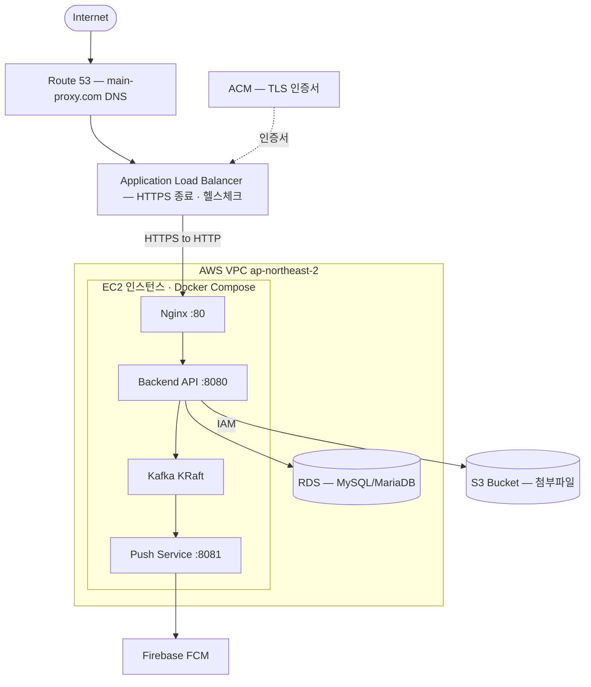
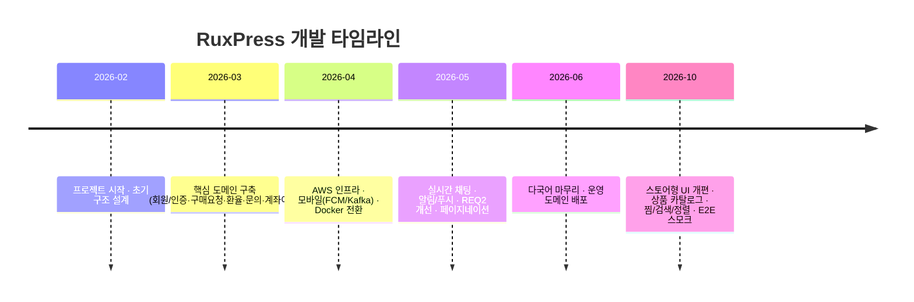

# Main Proxy — 엔지니어링 노트

> 제품 소개는 [README](../README.md)에 있습니다. 이 문서는 설계 결정, 도메인 구조, 인프라, 개발 과정을 깊이 있게 정리한 기록입니다.

## 목차

1. [핵심 성과](#1-핵심-성과)
2. [기술적 도전과 설계 결정](#2-기술적-도전과-설계-결정)
3. [백엔드 상세](#3-백엔드-상세)
4. [푸시 알림 마이크로서비스](#4-푸시-알림-마이크로서비스)
5. [Android 앱](#5-android-앱)
6. [AWS 클라우드 인프라](#6-aws-클라우드-인프라)
7. [개발 도구 · 워크플로우](#7-개발-도구--워크플로우)
8. [개발 타임라인](#8-개발-타임라인-커밋-이력-기반)

---

## 1. 핵심 성과

이 프로젝트에서 단순 CRUD를 넘어 **실서비스 수준의 엔지니어링 과제**를 직접 해결했습니다.

- 🏦 **금융 원장(Ledger) 설계** — 단순 잔액 컬럼이 아닌 **불변 원장 엔트리(Ledger Entry)** 기반으로 지갑/계좌이체 거래를 기록해 추적성과 정합성을 확보했습니다.
- 🔌 **헥사고날(포트·어댑터) 아키텍처 적용** — 은행 입금 검증을 `BankDepositVerificationPort` 인터페이스로 추상화하여, 수동 검증(`ManualDepositVerificationAdapter`)과 향후 자동 검증(웹훅)을 무중단 교체 가능하게 설계했습니다.
- 📨 **Kafka 기반 비동기 이벤트 파이프라인** — 백엔드와 푸시 서비스를 Kafka 토픽으로 느슨하게 결합하여, 알림 발송 실패가 핵심 트랜잭션에 영향을 주지 않도록 분리했습니다.
- 💬 **STOMP WebSocket 실시간 채팅** — JWT 인증 인터셉터를 통과하는 1:1 실시간 상담 채팅(파일 첨부 + 메시지 보존기간 자동 삭제 배치 포함)을 구현했습니다.
- 🌍 **풀스택 i18n** — 프론트(3개 로케일 JSON) + 백엔드(`Accept-Language` 기반 `MessageSource` 에러 메시지 변환)를 일관되게 다국어화했습니다.
- 📱 **하이브리드 모바일** — React 웹을 WebView로 래핑한 Android 앱에 FCM 푸시 + JS Bridge(인증 토큰 동기화)를 결합했습니다.
- 🚀 **Docker Compose 풀스택 오케스트레이션 + GitHub Actions 자동 배포** — `develop`/`master` 브랜치 푸시 시 SSH 무중단 재배포 파이프라인을 구성했습니다.
- 🖤 **스토어형 UI 전면 개편** — 셀렉트숍 레퍼런스를 페이지 단위로 리서치한 뒤, 색·둥근 모서리·그림자를 걷어낸 **흑백 에디토리얼 디자인 시스템**(`theme.css` 토큰 + `components/page` 키트)으로 사용자·관리자 37개 화면을 다시 조립했습니다. 코드·이미지·문구는 전부 자체 제작입니다.
- 🛍️ **상품 카탈로그·찜·검색·정렬** — 관리자가 등록한 상품(사진 업로드, 추천·노출·정렬)을 비회원도 둘러보고, 하트로 찜한 상품을 **한 번에 구매 요청으로** 넘기는 "장바구니 없는 커머스" 흐름을 설계했습니다. 조회수 기반 인기순, 2주 이내 NEW 표시, 최근 본 상품, 헤더 검색 시트까지 갖췄습니다.
- 🧪 **실제 백엔드로 도는 E2E 스모크 테스트** — H2 메모리 DB 위에서 Spring Boot와 Vite를 띄우고 Chromium이 관리자 상품 등록(이미지 업로드) → 비회원 탐색 → 로그인 게이트 → 찜 → 구매 요청 제출(지갑 차감)까지 **38개 검사**를 자동으로 수행합니다 (`script/e2e-smoke.sh`).

**코드 규모 (대략)**

| 구성 | 파일 수 | 비고 |
|------|--------:|------|
| 백엔드 Java | 277 | 15개 도메인, 35개 컨트롤러 |
| 프론트엔드 TS/TSX | 161 | 사용자 22 + 관리자 15 화면 |
| 푸시 서비스 Java | 20 | Kafka 컨슈머/프로듀서 + FCM |
| Android Kotlin | 6 | WebView + FCM |
| UI 컴포넌트 | 46 + 8 | Radix 기반 프리미티브 + 페이지 키트(PageHeader·Section·StatStrip 등) |
| 다국어 키 | 1,265 × 3 | ko · ru · en 동일 키 집합 |

---

## 2. 기술적 도전과 설계 결정

> 면접에서 이야기할 수 있는 "왜 이렇게 만들었는가"를 정리했습니다.

### 2.1 금융 정합성 — 불변 원장(Ledger) 패턴
잔액을 단일 컬럼으로 덮어쓰면 거래 추적이 불가능하고 동시성 버그에 취약합니다. 그래서 지갑(`UserWallet`)과 계좌이체(`TransferLedgerEntry`) 모두 **추가만 가능한 원장 엔트리**(`WalletLedgerEntry`, 타입: 충전/차감/관리자 조정 등)로 모든 변동을 기록하도록 설계했습니다. 잔액은 원장의 파생값으로 다루어 **모든 자금 이동에 감사 추적(audit trail)** 이 남습니다. 레거시 데이터는 `TransferLedgerLegacyMigration`으로 원장 모델에 맞춰 이관했습니다.

### 2.2 외부 연동 격리 — 헥사고날 포트·어댑터
은행 입금 확인은 초기엔 관리자 수동 검증이지만, 추후 오픈뱅킹/웹훅 자동화가 예정된 영역입니다. 이를 `BankDepositVerificationPort` 인터페이스로 추상화하고 `ManualDepositVerificationAdapter`로 구현해, **도메인 로직 변경 없이 검증 방식만 교체**할 수 있게 했습니다. 파일 스토리지도 동일하게 `FileStoragePort` → `Local`/`S3` 어댑터로 추상화하여 환경변수(`STORAGE_TYPE`)만으로 전환됩니다.

### 2.3 장애 격리 — Kafka 비동기 푸시 파이프라인
"구매요청 처리"가 성공했는데 "푸시 발송"이 실패해 전체 트랜잭션이 롤백되면 안 됩니다. 백엔드는 `ruxpress.notification.push.dispatch` 토픽으로 **이벤트만 발행**하고, 푸시 서비스가 이를 consume해 FCM으로 발송합니다. 디바이스 토큰 동기화(`user.device.sync`)와 발송 결과(`push.result`)도 토픽으로 분리해, 푸시 시스템 장애가 핵심 거래 흐름과 완전히 격리됩니다. (토픽 스키마는 [`../mobilePush/docs/kafka-contracts.md`](../mobilePush/docs/kafka-contracts.md))

### 2.4 실시간 채팅 — STOMP + JWT 인증 인터셉터
WebSocket은 HTTP 헤더 기반 인증이 매 메시지마다 적용되지 않습니다. 그래서 STOMP `CONNECT` 시점에 JWT를 검증하는 `ChatAuthChannelInterceptor`와 `ChatPrincipal`을 구현해, 인증된 사용자만 `/topic/chat/{roomId}` 구독·발행이 가능하도록 했습니다. 메시지 보존기간 설정(`ChatRetentionPeriod`)과 **스케줄 배치 자동 삭제**(`ChatMessageCleanupService`)로 개인정보 보존 정책도 충족했습니다.

### 2.5 풀스택 다국어 (i18n)
- **프론트**: `ko.json`/`ru.json`/`en.json` 로케일 리소스 + `I18nProvider`, `localStorage` 저장 언어를 `Accept-Language` 헤더로 전송.
- **백엔드**: `MessageConfig` + `MessageSource`로 **에러 메시지까지 로케일 변환** — 단순 UI 번역을 넘어 `BusinessException`의 메시지 키가 사용자 언어로 응답됩니다.
- 첫 방문 시 러시아어 기본값, 레거시 저장값(`ko`) 무시 등 실제 운영 이슈까지 반영.

### 2.6 인증 토큰 저장 전략 (프론트)
"자동 로그인"과 "이번 세션만"을 모두 지원하기 위해 `sessionStorage`를 우선 확인하고 없으면 `localStorage`를 사용하는 추상화(`readAuthValue`/`writeAuthValue`)를 두었습니다. 인증 상태 변화는 커스텀 이벤트(`USER_AUTH_CHANGE_EVENT`)로 브로드캐스트하고, Android WebView에서는 JS Bridge로 토큰을 동기화합니다.

### 2.7 디자인 시스템 — 토큰과 페이지 키트를 코드로
초기 화면은 페이지마다 색·여백·버튼이 조금씩 달랐습니다. 셀렉트숍 레퍼런스의 홈·카테고리·상품·계정 페이지를 Playwright로 열어 **글자 크기·자간·그리드·여백을 수치로 추출**한 뒤, 그 결을 `front/src/styles/theme.css`의 토큰(흑백 팔레트, radius 0, 가는 제목, 자간 넓은 라벨)과 `components/page` 키트(PageHeader · Section · StatStrip · DescriptionList · FormSection · Toolbar/Pager)로 옮겼습니다. 37개 화면이 같은 부품으로 조립되므로 토큰 한 줄을 바꾸면 관리자 화면까지 함께 바뀝니다. 중간에 파스텔·둥근 모서리 시안도 만들어 봤지만 "유아틱하다"는 피드백에 따라 되돌렸고, 그 과정이 토큰 교체만으로 가능했던 것이 이 구조의 효용이었습니다.

### 2.8 비회원 우선 — 화면을 막지 않는 로그인
예전에는 접속 즉시 로그인 화면이 전체를 막았습니다. 지금은 랜딩·상품·공지·이용 안내는 누구나 보고, 구매 요청·찜·문의처럼 계정이 필요한 순간에만 **로그인 시트**(`AuthGateProvider`, 데스크톱 다이얼로그 / 모바일 드로어)가 뜹니다. 로그인 후에는 `?next=`로 원래 목적지에 복귀하며, 열린 리다이렉트를 막기 위해 `safeNextPath`가 내부 경로만 허용합니다.

### 2.9 장바구니 없는 커머스 — 찜에서 구매 요청으로
구매대행은 "상품을 담아 결제"가 아니라 "링크를 보내 대신 사 달라"는 모델이라 장바구니가 어울리지 않습니다. 대신 상품 카드의 하트(찜, `product_wishlists`)로 상품을 모으고, 찜 목록에서 여러 개를 체크해 **상품명·링크·쇼핑몰·가격이 채워진 하나의 구매 요청**으로 넘기는 흐름을 설계했습니다(세션 저장소로 한 번만 전달). 상품 상세의 조회수(`view_count`)는 인기순 정렬과 "지금 많이 보는 상품"에 쓰이고, 사진은 관리자가 올린 파일만 쓰도록 하여 외부 쇼핑몰 이미지 저작권 문제를 구조적으로 피했습니다.

---

## 3. 백엔드 상세

### 도메인 구조 (`back/src/main/java/com/ruxpress/domain/`)
계층형(Controller → Service → Repository) 패턴을 15개 도메인에 일관 적용했습니다.

| 도메인 | 책임 |
|--------|------|
| `user` | 가입·로그인·JWT·이메일 인증·주소·디바이스 |
| `exchange` | CBR API 환율 수집(`CbrApiClient`), 수동/자동 환율, 다중 통화 |
| `balance` | 전자지갑(`UserWallet`) + 지갑 원장(`WalletLedgerEntry`) |
| `banktransfer` | 계좌이체 입금, 정산 계좌, 입금 검증 포트, 계좌 마스킹 |
| `product` | 관리자 큐레이션 상품 카탈로그(이미지 업로드, 추천·노출·정렬), 공개 목록 정렬(`ProductSort`), 조회수, 회원 찜(`ProductWishlist`) |
| `purchase` | 구매대행 요청 생명주기, 배송지 스냅샷, 상태 머신 v2 |
| `chat` | STOMP 실시간 채팅, 첨부, 보존기간 자동 삭제 |
| `inquiry` / `notice` | 1:1 문의 / 공지 |
| `notification` / `adminnotification` | 사용자/관리자 인앱 알림 |
| `transaction` | 거래 내역 |
| `admin` | 관리자 계정·역할 관리 |

### 공통 모듈 (`common/`)
- **`ApiResponse<T>`** — 모든 컨트롤러가 `code`/`message`/`data` 표준 응답 반환, `null` 데이터는 JSON에서 제외.
- **`BaseEntity`** — 모든 JPA 엔티티가 상속, `id`/`createdAt`/`updatedAt`/`deletedAt`(소프트 삭제) 제공.
- **`Attachment`** — `AttachmentRefType` 디스크리미네이터로 첨부 메타데이터 공용 관리.
- **글로벌 예외 처리** — `ErrorCode` + `BusinessException` + `GlobalExceptionHandler` 중앙 집중.

### 보안 (`config/`)
- `JwtAuthenticationFilter`가 매 요청 `Authorization: Bearer` 헤더에서 주체(사용자/관리자 ID)와 역할을 추출.
- 역할: `SUPER_ADMIN` · `COUNSELOR` · `USER` (JWT 페이로드에 임베드). 상품 관리(`/api/v1/admin/products/**`)는 SUPER_ADMIN, 공개 상품 조회(`GET /api/v1/products/**`)·공지는 비회원 허용, 찜(`/api/v1/wishlist/**`)은 회원 JWT 필수.
- CORS, 업로드 크기(파일당 10MB / 요청당 60MB), ALB 프록시 헤더 등 운영 설정 반영.

### Spring 프로필
| 프로필 | DB | Kafka | DDL | 비고 |
|--------|------|------|-----|------|
| `h2` | H2 in-memory | 사용 안 함 | create-drop | 시드 계정, 로컬 파일 저장소. `mvn spring-boot:run -Dspring-boot.run.profiles=h2`, E2E 스모크 |
| `local` (기본) | MariaDB(env `DB_*`) | localhost:9092 | validate | 시드 계정 |
| `dev` | MariaDB | localhost:9092 | validate | |
| `docker` | MariaDB(`mariadb` 호스트) | kafka:29092 | update | 시드 계정 |
| `prod` | MariaDB(env) | env 기반 | none | 스키마는 `sql/DDL.sql` + 마이그레이션으로 관리 |

---

## 4. 푸시 알림 마이크로서비스

`mobilePush/` — Kafka 컨슈머로 동작하는 독립 Spring Boot 서비스.

- **`PushDispatchKafkaListener`** → `FcmDispatchService` → Firebase Admin SDK로 FCM 발송.
- **`UserDeviceSyncKafkaListener`** → 사용자 디바이스 토큰(`PushDevice`) 동기화.
- **발송 이력**(`PushDeliveryAttempt`)을 PostgreSQL에 기록, Flyway(`V1__push_schema.sql`)로 스키마 관리.
- Firebase 자격증명은 Docker secret(`/run/secrets/firebase-admin.json`)으로 주입.

**Kafka 토픽**

| 토픽 | 방향 | 용도 |
|------|------|------|
| `ruxpress.notification.push.dispatch` | Backend → Push | FCM 푸시 트리거 |
| `ruxpress.user.device.sync` | Backend → Push | 디바이스 토큰 동기화 |
| `ruxpress.notification.push.result` | Push → Backend | 발송 결과(선택) |

---

## 5. Android 앱

`app/android/` — React 웹을 감싸는 하이브리드 앱.

- **WebView 래핑**: `MainActivity`가 운영 웹을 로드(개발 시 `local.properties`의 LAN IP/에뮬레이터 `10.0.2.2`로 전환).
- **JS Bridge**(`WebAppInterface`): 웹↔네이티브 양방향 통신으로 인증 토큰·푸시 컨텍스트(`PushContextSync`) 동기화.
- **FCM 수신**(`RuxpressFcmService`): 백그라운드 푸시 알림 처리.
- **릴리스 서명**: `keystore.properties` 기반 서명 설정(예시 파일 제공).

---

## 6. AWS 클라우드 인프라

운영 환경(`https://main-proxy.com`)은 **AWS 서울 리전(`ap-northeast-2`)** 위에 구축되어 있습니다.

### 구성 요소

| AWS 서비스 | 역할 | 비고 |
|-----------|------|------|
| **Route 53** | `main-proxy.com` / `www.main-proxy.com` DNS 라우팅 | CORS 허용 도메인과 일치 |
| **ALB (Application Load Balancer)** | HTTPS(TLS) 종료, 트래픽 분산, 헬스체크 | `X-Forwarded-*` 프록시 헤더로 원본 IP/프로토콜 전달 |
| **ACM** | TLS 인증서 발급·자동 갱신 | ALB에 연결 |
| **EC2** | Docker Compose 풀스택 호스팅 | `setup-swap.sh`로 스왑 구성 |
| **RDS** | 관리형 관계형 DB (거래·원장) | 셋업 스크립트 `script/aws/.../03-rds-mysql` |
| **S3** | 첨부파일 오브젝트 스토리지 | `FileStoragePort`의 S3 어댑터, 전용 IAM 사용자 |
| **IAM** | S3 접근 최소권한 사용자 | `02-iam-s3-user` 스크립트로 생성 |

> AWS 리소스 프로비저닝은 `script/aws/`에 **Linux(sh)·Windows(PowerShell) 양쪽 IaC 스크립트**로 자동화되어 있습니다 — DB 서브넷 그룹 → S3 버킷 → IAM 사용자 → RDS 순서(`run-all`).

### EC2 내부 — Docker Compose 풀스택
`docker-compose.yml` 하나로 6개 컨테이너 오케스트레이션:
`mariadb` · `kafka`(KRaft) · `push-postgres` · `mobilepush` · `backend` · `frontend(nginx)` — healthcheck 기반 의존성 순서 제어.

| 서비스 | 포트 | 비고 |
|--------|------|------|
| Frontend (Nginx) | 80 | 정적 서빙 + 리버스 프록시 (업로드 60MB 제한) |
| Backend API | 8080 | `/api/health` 헬스체크 |
| Push Service | 8081 | FCM 디스패처 |
| Kafka | 9092(host) / 29092(내부) | KRaft 모드 |
| MariaDB / RDS | 3306 | 거래/원장 |
| PostgreSQL(push) | 5433 | 푸시 전용 |

---

## 7. 개발 도구 · 워크플로우

이 프로젝트는 **AI 페어 프로그래밍**과 **디자인→코드 자동화** 도구를 적극 활용해 생산성을 높였습니다.

| 도구 | 용도 |
|------|------|
| 🤖 **Claude Code** | AI 페어 프로그래밍 — 도메인 설계, 리팩터링, 다국어 처리, 코드 리뷰 |
| 🖱️ **Cursor** | AI 코드 에디터 — 인라인 편집·자동완성 |
| 🎨 **디자인 시스템(코드)** | 레퍼런스 리서치 → `theme.css` 토큰 + 페이지 키트로 직접 구현, 목 API(Playwright)로 51개 화면 ko/ru·데스크톱/모바일 자동 스크린샷 점검 |
| 🐳 **Docker / Docker Compose** | 로컬·운영 동일 컨테이너 환경 |
| 🔧 **Git · GitHub · GitHub Actions** | 기능 브랜치(REQ-xxx) 전략 + CI/CD 자동 배포 |

---

## 8. 개발 타임라인 (커밋 이력 기반)

2026-02 ~ 2026-06, 약 4개월간 요구사항 단위(`REQ-xxx`) 기능 브랜치 전략으로 단계적으로 개발했습니다. (총 ~170 커밋, 커밋 메시지 기준)

| 시기 | 단계 | 주요 작업 |
|------|------|-----------|
| **2026-02** | 🏗️ 착수 | 프로젝트 초기 구조 설계(`init`), 백엔드·프론트 스캐폴딩, DB DDL |
| **2026-03** | 🧩 핵심 도메인 | **REQ-001** 이메일 회원가입·로그인·인증·마이페이지·비밀번호 찾기 · **REQ-002** 구매요청 · **REQ-005** 자동 환율 계산 · **REQ-007** 관리자/대시보드 · **REQ-016** 잔액 시스템(초기) · **REQ-017** 계좌이체·원장(Ledger) · 1:1 문의/답변(스토리지 DIP) · 모바일 푸시 초기 코드 · 다국어 방향 정립 |
| **2026-04** | ☁️ 인프라·모바일 | **AWS** S3 업로드·RDS·설정 · **REQ-006** 안드로이드 초기 설정 + FCM 토큰 + **Kafka 푸시 구현** · **전체 스택 Docker 전환** · 잔액 포인트 차감·환불 |
| **2026-05** | 🚀 고도화 (최다, 112커밋) | **REQ-009 실시간 채팅(STOMP)** · 관리자 알림 시스템(구매요청·입금·문의·채팅) · 채팅·구매상태·문의 **푸시 알림** · **REQ2 개선 시리즈**(자동로그인·JWT 7일, 구매요청 항목별 단가/수량, 입금 이미지 첨부, 운송장번호, 회원 검색, 수수료율, 환율 스왑) · **Android WebView 마감**(파일 선택·노치·런처 아이콘) · 다통화 환율(USD/CNY) · **전 페이지 서버사이드 페이지네이션** · 에스크로 제거·계좌이체 단순화 |
| **2026-06** | 🌍 운영 배포 | 프론트·백엔드 **다국어 전면 마무리** · 기본 언어 러시아어 통일 · **운영 도메인(main-proxy.com) CORS·ALB 프록시 헤더·Nginx 업로드 제한** · 브랜딩(Main Proxy)·관리자 공지 |
| **2026-10** | 🖤 스토어 전환 | **흑백 에디토리얼 디자인 시스템**(토큰 + 페이지 키트)으로 37개 화면 재조립 · 비회원 랜딩 + **로그인 시트** · **상품 카탈로그**(관리자 등록·이미지 업로드·추천/노출) · **찜 → 구매 요청** 흐름 · 검색 시트·정렬·조회수·최근 본 상품·이용 안내 · 구매 요청 폼 다국어 보강 · **실제 백엔드 E2E 스모크(38개 검사)** · **서비스 소개 히어로 아트워크 + 관리자 히어로 이미지** |

> 커밋 활동은 **2026년 5월에 집중**(전체의 65%)되었으며, 이 시기에 실시간 채팅·푸시 알림·REQ2 개선·페이지네이션 등 사용자 경험 핵심 기능이 완성되었습니다. 2026년 10월에는 서비스 전체를 스토어형 UI로 다시 설계하고 상품·찜·검색 기능과 E2E 테스트를 더했습니다.
